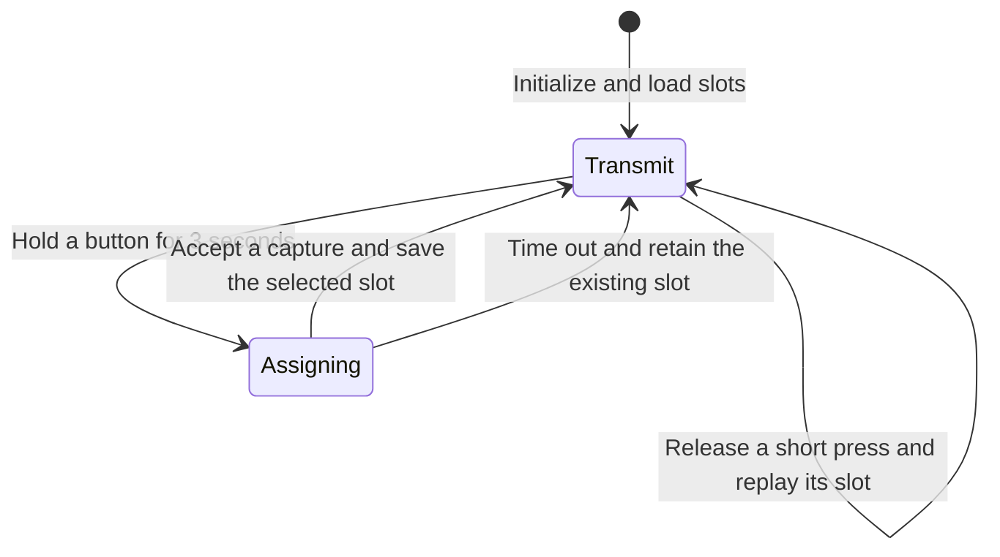

# ESP32 IR Cloner firmware

The cloner stores the timing of an infrared command in one of two slots and sends that timing again when the matching button is pressed. The slots are labeled `ON` and `OFF` for the air-conditioner prototype. Each slot holds whatever command was taught to it. For hardware, pin assignments, and setup, see the [build guide](../README.md).

## Program structure

| Source | Role |
| --- | --- |
| [src/main.cpp](../src/main.cpp) | Initializes the hardware, restores saved signals, and routes button events to learning or replay. |
| [src/button.cpp](../src/button.cpp) | Polls the two active-low buttons and generates short-press and hold events. |
| [src/ir_controller.cpp](../src/ir_controller.cpp) | Runs the learning window, converts captures into raw timings, transmits signals, and drives the status LED. |
| [src/storage.cpp](../src/storage.cpp) and [include/storage.h](../include/storage.h) | Define the two in-memory slots and load or save them using ESP32 Preferences. |
| [include/config.h](../include/config.h) | Defines the pin numbers, button timings, capture limits, and transmit carrier. |

At boot, `setup()` starts the 115200-baud serial connection, configures the status LED and buttons, initializes the IR transmitter, and calls `loadSignals()`. The receive input is enabled when learning begins.

In `STATE_TRANSMIT`, `handleButton()` polls each input. It accepts a change when more than 30 ms have elapsed since the last accepted change. A short-press event fires on release. A hold fires once after 3,000 ms, records the selected slot as `targetButton`, and suppresses replay when that button is released. In `STATE_ASSIGNING`, `assignSignal(targetButton)` runs to completion before the main loop resumes button polling.

## How the receiver learns a signal

1. **Open the learning window.** `assignSignal()` enables the receiver on GPIO14 for up to 5,000 ms. It toggles the status LED every 250 ms while waiting. The first accepted capture ends the window early.
2. **Measure the envelope.** The KY-022 turns received IR bursts into a digital signal. `IRrecv` timestamps its edges and records the intervals in a 1,024-entry capture buffer. The 50 ms receiver timeout ends a capture after a gap with no edges. This timeout is separate from the five-second learning window. The receiver provides the envelope of the signal, so the individual carrier cycles and their frequency are absent from the capture. [KY-022 receiver specifications](https://sensorkit.joy-it.net/en/sensors/ky-022) · [IRremoteESP8266 receiver implementation](https://github.com/crankyoldgit/IRremoteESP8266/blob/v2.9.0/src/IRrecv.cpp)
3. **Check the capture.** After `irrecv.decode()` reports a result, the firmware rejects a receiver overflow, a corrected length below 20 timings, or a corrected length above 1,024 timings. It resumes reception after a rejected result while time remains. The protocol name printed to serial is diagnostic. An `UNKNOWN` result can be saved if it passes the timing checks and the conversion succeeds.
4. **Convert and copy.** `getCorrectedRawLength()` counts the replay entries. `resultToRawArray()` skips the initial gap entry and converts capture ticks to microseconds. It can split a duration that exceeds a 16-bit entry while preserving the mark/space order. The cloner copies the array into the chosen slot and frees the temporary array. [IRremoteESP8266 raw timing helpers](https://github.com/crankyoldgit/IRremoteESP8266/blob/v2.9.0/src/IRutils.cpp)
5. **Close and report.** The firmware disables the receiver. After an accepted capture, it calls `saveSignal()`, prints `Saved.`, and blinks three times. If the window ends without an accepted capture, it prints `Nothing saved.`, gives one long blink, and retains the previous assignment.

## What is stored and how reassignment works

Each RAM slot is a `Signal` with a `uint16_t len` and a `uint16_t data[1024]` array. `len` counts timing entries. A zero length marks an empty slot. Each used entry is a duration in microseconds. The array starts with a **mark**, an interval with the IR carrier on. A **space**, an interval with the carrier off, follows it. The entries continue alternating in that order.

The Arduino `Preferences` API stores the slots in ESP32 non-volatile storage (NVS), a key-value store in flash. Both slots use the `irclone` namespace. [Arduino-ESP32 Preferences API](https://docs.espressif.com/projects/arduino-esp32/en/latest/api/preferences.html)

| Slot | Length key and type | Data key and format |
| --- | --- | --- |
| `0` (`ON`) | `len0`, unsigned 16-bit entry count | `dat0`, `len0 × 2` bytes of raw `uint16_t` timings |
| `1` (`OFF`) | `len1`, unsigned 16-bit entry count | `dat1`, `len1 × 2` bytes of raw `uint16_t` timings |

On boot, `loadSignals()` defaults a missing length to zero and only attempts to read data for lengths from 1 through 1,024. Once saved successfully, a command survives a reset or power cycle. Reassigning a button replaces its RAM slot and writes to the same pair of flash keys. The other slot keeps its own values.

`saveSignal()` writes the length and blob in separate calls and ignores their return values. `loadSignals()` checks the length's range but ignores the byte count returned by `getBytes()`. A failed or interrupted save can therefore leave the length and data out of sync. `Saved.` means a capture was accepted and the save was attempted. Power-cycle and replay to verify persistence. For an integration that needs dependable updates, store the length and timings together in one record per slot, validate the record on load, and surface storage errors. Preserve the existing keys or add a migration if previously learned commands need to carry over.

## How replay drives the emitter

`transmitSignal(i)` first checks `sig[i].len`. For an empty slot, it logs that there is no stored signal and gives one long blink. For a populated slot, it turns on the status LED and calls `irsend.sendRaw(sig[i].data, sig[i].len, 38)`, then turns the status LED off. `sendRaw()` produces a **38 kHz** pulse train on GPIO4 during each mark and keeps the emitter off during each space. That carrier is a firmware constant shared by both slots. Each short press plays the stored sequence once, including any repeated portions present in that capture. [IRremoteESP8266 raw transmit implementation](https://github.com/crankyoldgit/IRremoteESP8266/blob/v2.9.0/src/IRsend.cpp)

Replay is one-way. The `[TRANSMIT ...]` log records the attempt, and the cloner has no feedback about whether the appliance received the command or changed state. A remote that uses a different carrier or sends parts of a command more than 50 ms apart may need different capture and replay settings. Long commands can also exceed the buffer.

## Reuse in an air-conditioner controller

| Integration | What to reuse or adapt |
| --- | --- |
| **Timers, sensors, or network commands on the same ESP32** | Initialize the status LED, `initIR()`, and `loadSignals()` as the prototype does. Call `transmitSignal(0)` or `transmitSignal(1)` from the controller's event loop. The button module is optional if commands arrive through another interface. Validate slot indexes before passing them to the existing functions. |
| **A separate IR node** | Keep capture, storage, and emission on the cloner ESP32. Add an interface such as serial or MQTT that maps commands to slot indexes. Keep command acceptance separate from confirmation of appliance state. The current serial interface only prints logs. |
| **Learn once, deploy elsewhere** | Export the timing count and array in microseconds and carry the carrier frequency alongside them. A second board using IRremoteESP8266 can replay the array with `sendRaw()`. The current firmware logs the count and protocol name, so exporting the timing values requires adding an output path. |
| **Temperature, fan, and mode control** | If the remote sends a full state, teach each desired state as a preset and allocate more slots as needed. For adjustable settings on a supported model, consider the library's `IRac` API to generate commands for that model. [IRremoteESP8266 A/C API](https://github.com/crankyoldgit/IRremoteESP8266/blob/v2.9.0/src/IRac.h) |

For a fixed two-command controller, learn explicit on and off commands if the original remote can send them. If it sends a toggle, replaying the slot will toggle power, so the result depends on the unit's current state. Test both commands on the actual appliance, including what settings the unit applies after replay.

The current learning loop blocks button polling for up to five seconds, followed by synchronous flash writes and LED feedback on success. Transmission is synchronous too. In a controller that must keep servicing sensors or communications, turn learning and feedback into operations that advance across loop iterations, or give IR work a dedicated worker. Serialize learning and transmission so a slot cannot be overwritten while another part of the system is replaying it.
